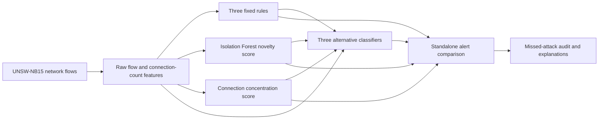

# Explainable Cyber Threat Defense Workbench: project guide

## Research question

Can three understandable detection signals help trained models identify attack-labeled network flows, and how much extra review work is required to recover attacks that the selected model misses?

This project deliberately matches the structure of [Explainable AML Transaction Monitoring](https://github.com/codewithdaniel1/Explainable-AML-Transaction-Monitoring): one notebook, separately evaluated detection tracks, three classifier alternatives, a held-out alert comparison, model explanations, and a report of missed labels. Its single use case is **network-flow attack detection**.

## Architecture at a glance

**Tracks are signals, classifiers are alternatives.** The rule flags and continuous anomaly/concentration scores are model inputs, but each track's own alerts are evaluated separately. Every model scores every eligible validation and test flow.

## Data and split

The [dataset authors](https://research.unsw.edu.au/projects/unsw-nb15-dataset) describe cyber-range normal traffic and nine simulated attack types. We use their published 175,341-row training CSV and 82,332-row testing CSV. `label` is the binary target. `attack_cat` is reserved for the final audit. `id` is excluded.

The published CSVs have no timestamp, so there is no honest chronological split. We keep the published test apart and use a grouped random split within the published training CSV for fit and validation. Grouping by a hash of all input fields keeps identical feature rows on one side of that fit/validation split.

The notebook audits exact duplicates and finds **8,541 published test rows whose input fields match a row in the published training file**. The primary test evaluation excludes those rows, leaving **73,791**. This is a conservative way to remove exact cross-split overlap; it cannot remove all correlation among traffic sessions. There are also 229 groups of identical training inputs with conflicting binary labels, which is a label-quality limitation.

## Detection tracks

1. **Rules:** three fixed, readable flags for an unanswered multi-packet flow, a repeated source/destination-port pattern, and a short high-rate flow. Their thresholds are illustrative and not tuned on validation or test labels.
2. **Isolation Forest:** a one-class model fit on **normal-labeled fit rows**. This is a novelty reference, not a fully label-free model over the attack-heavy stream. The standalone alert cutoff is the 90th percentile of validation anomaly scores.
3. **Connection concentration:** the sum of log-transformed recent-connection counts for source/port and source/destination relationships. The [feature definitions](https://huggingface.co/datasets/Mouwiya/UNSW-NB15/blob/main/NUSW-NB15_features.csv) describe the supplied counts. The standalone cutoff is the 90th percentile of validation scores. This is a simple count signal, not a graph model.

The three classifiers use 17 selected numeric flow/count fields, `proto`, `service`, and `state`, plus all three rule flags and the two continuous track scores. Logistic regression and XGBoost use preprocessing fit only on the fit split. EBM reads the same underlying fields directly.

## Model selection and alert comparison

Validation **average precision (AP)** selects the model family. A model score threshold at the validation 90th percentile is then frozen for test; its test alert count can change when score distributions shift. The notebook also gives each model a separate **10% test review budget** as a ranking sensitivity check. This top-N comparison does not use test labels to choose rows.

The main track-versus-model comparison holds workload equal: the selected model ranks exactly as many primary-test flows as the rule union alerts. It then counts extra attack-labeled and normal-labeled flows that each track would add beyond that model queue. A union's higher recall is only useful if its extra review volume is acceptable.

| Metric | Meaning here |
| --- | --- |
| AP | How well scores rank attack labels over thresholds. |
| Precision | Attack-labeled flows divided by alerted flows in this synthetic benchmark. |
| Recall | Alerted attack-labeled flows divided by all attack-labeled flows. |
| False-positive rate | Normal-labeled flows alerted divided by all normal-labeled flows. |
| Alert volume | Count of flow rows sent for review, not distinct incidents or analysts' cases. |
| Brier score | Mean squared error of predicted probabilities against binary labels; lower is better. |

## How to read the result

Read [FINDINGS.md](FINDINGS.md) for measured tables and misses. UNSW-NB15's published split is **attack-heavy**: 68.1% of training rows and 55.1% of published test rows have attack labels. Real security operations often have a very different base rate. The unusually high AP and precision in this experiment should be interpreted as dataset-specific. The repository demonstrates a research workflow and explains the strengths and limits of each detector on this benchmark.

