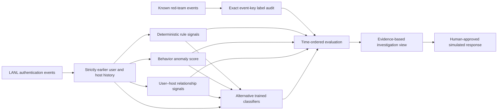

# Project guide

## Research question and use case

**Can past-only identity activity features improve detection of known red-team authentication events while keeping alert volume reviewable?** The unit of analysis is one LANL authentication event. Each event can receive a rule flag, an anomaly score, and a supervised score. Later work will add process, DNS, and flow context to an analyst investigation view.

This structure follows the [AML project](https://github.com/codewithdaniel1/Explainable-AML-Transaction-Monitoring): distinct detection tracks, alternative trained classifiers, a time-ordered comparison, explanation of scores, and an audit of missed known events. The cyber use case adds a governed analyst assistant and simulated response workflow after the research core is credible.

## Architecture

The three tracks are **signals**, while logistic regression, gradient-boosted trees, and an interpretable additive model are planned **alternative classifiers**. A classifier should score every eligible evaluation event; a rule alert should not silently filter the model's population. Track alerts and model alerts will be compared separately before any combined policy is considered.

## Data and label contract

The [LANL source](https://csr.lanl.gov/data/cyber1/) describes 58 days of de-identified authentication, process, DNS, network-flow, and known red-team events. Stage 1 uses `auth.txt.gz` and `redteam.txt.gz`. The red-team event key is `(time, source user, source computer, destination computer)`. The preparation manifest reports how many distinct keys matched the auth stream; unmatched keys must be investigated before evaluation.

The red-team file identifies specific known bad events. It is not an exhaustive inventory of all malicious activity, and other events are not confirmed benign. This makes **known-red-team recall** and **alert volume per day** stronger primary measures than unqualified precision. A calculated precision using all other events as negatives may be included only as a clearly labeled proxy. A positive label may also be too sparse in a short development slice for model training or a meaningful split.

## Leakage controls

- Input records must be ordered by timestamp. The preparer rejects an out-of-order stream.
- Historical counts use events at strictly earlier timestamps. Events sharing a timestamp see the same previous history.
- Event identity fields support joins and history but are excluded from classifier inputs to avoid memorizing anonymized IDs.
- A chronological split and expanding time folds will be used. Split boundaries must be selected from the available days and published before final test evaluation; each period's known-event count must be checked.
- Feature selection and alert thresholds use training and validation data. The later test period is reserved for final comparison and missed-event audit.
- Any capped development run is identified in its manifest and must not be reported as a full-dataset score.

## Planned research stages

| Stage | Work | Exit evidence |
| --- | --- | --- |
| 1. Data and features | Stream authentication events; exact red-team join; past-only user/host counts; data profile. | Label-match manifest, feature checks, and time/volume plots. |
| 2. Detection tracks | Readable rules, Isolation Forest, and user–host novelty signal. | Alert counts, known-event coverage, overlap, and workload by day. |
| 3. Classifiers | Logistic regression, XGBoost, and Explainable Boosting Machine on shared inputs. | Time-fold comparison, validation threshold selection, test ranking and workload metrics. |
| 4. Investigation | Evidence timeline, model explanations, missed-event audit, ATT&CK context. | Reproducible case studies with retrieved event IDs. |
| 5. AI and operations | Retrieved runbooks, tool-assisted investigation, prompt-injection checks, event replay, model registry, drift dashboard, simulated response. | Grounding evaluation, audit log, replay test, and operator guide. |

For the eventual alert policy, evaluate **known-event recall**, known-event coverage at fixed daily review budgets, alerts per day, unique accounts affected, calibration where meaningful, and time to score. Inspect failure cases by time and authentication type. Report data-label limitations next to every result.

## Current implementation

`scripts/prepare_lanl.py` implements Stage 1 ingestion and features. The notebook performs Stage 1 audit and an initial transparent rule comparison. The remaining stages above are the build sequence, not claims of completed results.

