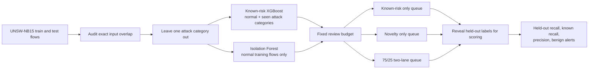

# Project guide: open-world network-flow triage

## Research question

When an attack category is absent from training, can a normal-only novelty score surface it in a fixed-size review queue, and what is the trade-off against known-attack ranking and benign review volume?

This is a small, transparent benchmark on UNSW-NB15. Its contribution is the controlled comparison of triage policies under the same review budget. It does not claim a new detector or a production-ready SOC design.

## Why evaluate open-world detection?

A closed-set classifier learns from the labels available to it. Real network monitoring can encounter behavior outside those examples, so research evaluates unknown-class recognition, novelty scoring, and continual adaptation. These topics are active: for example, 2025 work studies open-world network intrusion detection with recognition and inspection, while SPIDER studies semi-supervised continual learning under distribution shifts ([ORI, IEEE 2025](https://ieeexplore.ieee.org/document/11159092/); [SPIDER, IEEE INFOCOM 2024](https://newslab.iith.ac.in/publications/spider-a-semi-supervised-continual-learning-based-network-intrusion-detection-system/)).

Here the unknown-category setup is deliberately narrow and reproducible. UNSW-NB15 categories are held out as benchmark classes; they are not literal zero-day events or a complete taxonomy of real threat families.

## System design

### Evaluation protocol

For each attack category, the notebook removes its attack rows from training and also removes any remaining training row with an identical input fingerprint. The primary test data are fixed across folds after exact train/test input duplicates are removed. The known-risk model sees the binary `label` for normal and seen attack categories, but `attack_cat` is never an input. The Isolation Forest is fit only on normal training flows.

Each model creates rankings without reading test labels. At each budget, all three policies select the same number of rows:

- **Known-risk only:** top rows by XGBoost attack score.
- **Novelty only:** top rows by Isolation Forest anomaly score.
- **Two-lane 75/25:** 75% of slots from known-risk ranking, then 25% from novelty ranking among rows not already selected.

The 75/25 allocation is a simple benchmark policy. It is not tuned on the held-out test labels. Budgets are 5%, 10%, and 20%; 10% is the main result.

## Data and features

The [UNSW-NB15 release](https://research.unsw.edu.au/projects/unsw-nb15-dataset) contains cyber-range normal and attack traffic. The published training file has 175,341 flows and the testing file has 82,332. Removing exact input matches from test leaves 73,791 primary test flows.

The model uses 17 numeric fields: `dur`, `spkts`, `dpkts`, `sbytes`, `dbytes`, `rate`, `sttl`, `dttl`, `sload`, `dload`, `sloss`, `dloss`, `ct_srv_src`, `ct_dst_ltm`, `ct_src_dport_ltm`, `ct_dst_sport_ltm`, `ct_dst_src_ltm`; and three categorical fields: `proto`, `service`, `state`. The Isolation Forest uses eight numeric flow fields: `dur`, `spkts`, `dpkts`, `sbytes`, `dbytes`, `rate`, `sload`, `dload`.

`label` is the normal/attack outcome. `attack_cat` defines folds and supports post-ranking evaluation only. `id` is an identifier. All three are excluded from model inputs.

## Measures

| Measure | Meaning |
| --- | --- |
| Held-out-category recall | Fraction of examples from the withheld category selected into the queue. |
| Known-category recall | Fraction of examples from the other attack categories selected. |
| Overall attack recall | Fraction of all attack-labeled test flows selected. |
| Precision | Attack-labeled selected flows divided by all selected flows. Dataset-specific. |
| Normal alerts per 1,000 | Selected normal-labeled flows per 1,000 normal-labeled test flows. |
| Held-out precision in novelty lane | Held-out-category hits divided by novelty-lane selections. |

The notebook reports category-macro averages across categories with at least 100 primary-test examples. The `Worms` category has only 44 primary-test examples and is shown separately rather than included in the supported-category macro.

## How to interpret the benchmark

The 10% primary-budget result shows a tension: novelty-only has the highest supported-category held-out recall (13.3%) but also the most normal alerts (about 67 per 1,000 normal flows). The two-lane policy lowers held-out recall to 4.6%, while reducing normal alerts to about 18.5 per 1,000. Known-risk-only has near-zero macro held-out recall (0.2%) despite very high benchmark precision, illustrating why known attack ranking alone does not answer the unknown-category question.

These are category-macro results on one cyber-range split, not evidence of effectiveness in operational traffic. The 2025 IEEE open-world recognition and inspection paper is a relevant research comparator; the project should be framed as a transparent benchmark and queue-policy study, not as a novel industry architecture.

## Limits

- “Unknown” is a withheld dataset category, not a zero-day event.
- The published data have no timestamps; there is no temporal or future-drift evaluation.
- The test set is attack-heavy and cyber-range generated. Precision and alert counts do not transfer directly to a live SOC.
- `Worms` has low support; category recall is noisy.
- Exact duplicate filtering addresses exact input matches, not broader dependence among flows.
- Dataset-provided connection-count fields cannot be rebuilt independently from the published split files.

## Sources

- Moustafa, N. and Slay, J. (2015), “UNSW-NB15: a comprehensive data set for network intrusion detection systems,” [DOI 10.1109/MilCIS.2015.7348942](https://doi.org/10.1109/MilCIS.2015.7348942).
- “Toward Open-World Network Intrusion Detection via Open Recognition and Inspection,” IEEE 2025, [IEEE Xplore](https://ieeexplore.ieee.org/document/11159092/).
- “SPIDER: A Semi-Supervised Continual Learning-Based Network Intrusion Detection System,” IEEE INFOCOM 2024, [project page](https://newslab.iith.ac.in/publications/spider-a-semi-supervised-continual-learning-based-network-intrusion-detection-system/).
